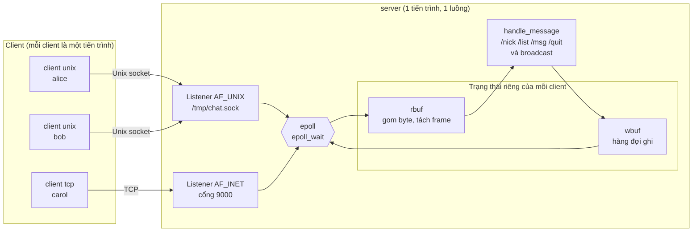
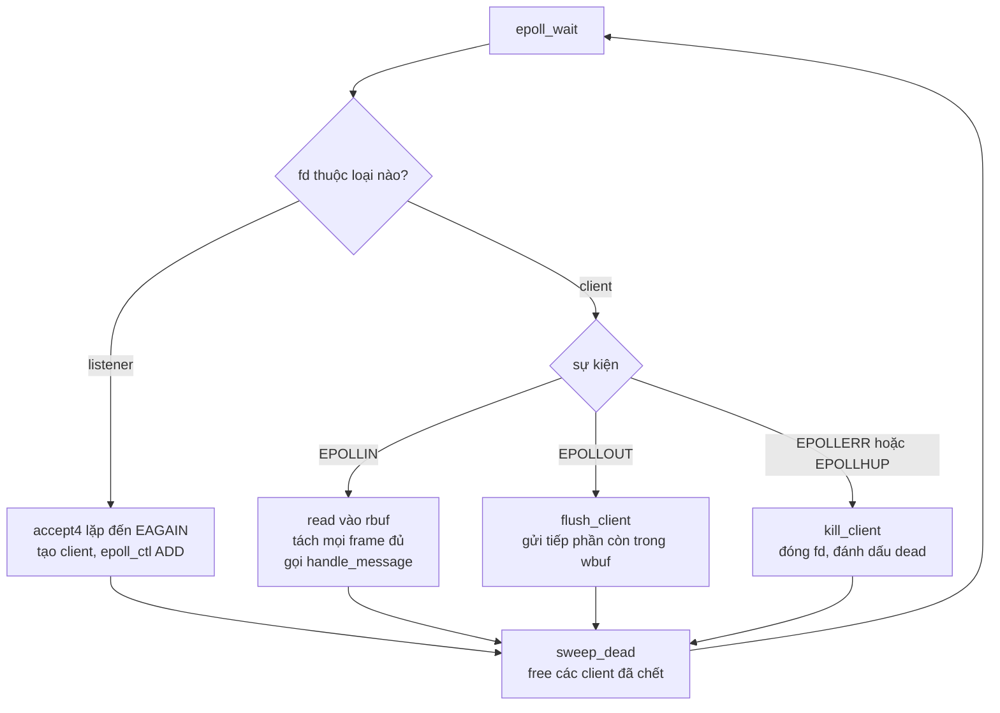
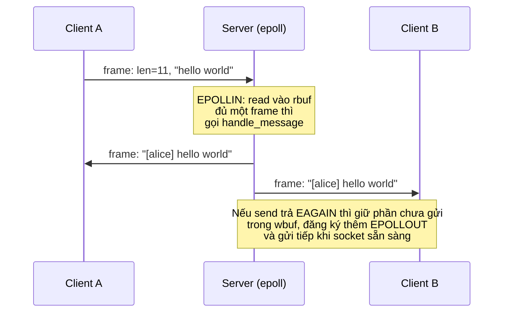

# Chat server đa client bằng `epoll` — Sockets trong IPC

Đồ án cuối kỳ môn **Lập trình hệ thống** · Ngôn ngữ **C** · Nền tảng **Linux (Arch)**

Một chat server đơn tiến trình, đơn luồng, phục vụ **đồng thời** client kết nối qua
**Unix domain socket** (`AF_UNIX`) và **TCP** (`AF_INET`) bằng cơ chế `epoll` non-blocking.
Kèm chương trình **benchmark** so sánh độ trễ và thông lượng của các cơ chế IPC:
pipe, Unix stream, Unix datagram, Unix seqpacket và TCP loopback.

## Mục lụca

1. [Socket trong bức tranh IPC](#1-socket-trong-bức-tranh-ipc)
2. [Kiến trúc](#2-kiến-trúc)
3. [Giao thức](#3-giao-thức)
4. [Cấu trúc thư mục](#4-cấu-trúc-thư-mục)
5. [Build và chạy](#5-build-và-chạy)
6. [Kịch bản demo](#6-kịch-bản-demo)
7. [Benchmark](#7-benchmark)
8. [Ghi chú thiết kế](#8-ghi-chú-thiết-kế)
9. [Hạn chế](#9-hạn-chế)
10. [Xử lý sự cố](#10-xử-lý-sự-cố)

---

## 1. Socket trong bức tranh IPC

| Cơ chế | Phạm vi | Hướng | Ranh giới tin nhắn | Ghi chú |
|---|---|---|---|---|
| Pipe / FIFO | Cùng máy | Một chiều | Không (byte stream) | Pipe cần quan hệ cha-con; FIFO có tên trong hệ thống file |
| Message queue (POSIX/SysV) | Cùng máy | Hai chiều qua hàng đợi | Có | Có độ ưu tiên; giới hạn kích thước theo cấu hình hệ điều hành |
| Shared memory | Cùng máy | Hai chiều | Tự quản | Nhanh nhất vì không sao chép, nhưng phải tự đồng bộ (semaphore/mutex) |
| **Unix domain socket** | Cùng máy | Hai chiều | Tùy loại (`STREAM` không, `DGRAM`/`SEQPACKET` có) | Có địa chỉ là đường dẫn file, có thể truyền file descriptor (`SCM_RIGHTS`), đọc được PID/UID của đối phương (`SO_PEERCRED`) |
| **TCP/UDP socket** | Khác máy | Hai chiều | `TCP` không, `UDP` có | Đi qua network stack, dùng được qua mạng |

Đồ án dùng hai loại socket đầu và cuối: **`AF_UNIX` + `SOCK_STREAM`** và **`AF_INET` + `SOCK_STREAM`**.
Vì cả hai đều là byte stream nên một `read()` **không** tương ứng với một tin nhắn;
đó là lý do giao thức có *framing* (xem [mục 3](#3-giao-thức)).

---

## 2. Kiến trúc

### 2.1 Thành phần



Một `epoll` instance theo dõi cả hai socket lắng nghe lẫn mọi socket client.
Mỗi đối tượng đăng ký vào epoll bắt đầu bằng `struct handle { kind, fd }`, nên con trỏ
`epoll_event.data.ptr` cho biết ngay đó là listener Unix, listener TCP hay một client.

### 2.2 Vòng lặp sự kiện



### 2.3 Đường đi của một tin nhắn



---

## 3. Giao thức

Mỗi tin nhắn là một **frame** với tiền tố độ dài (*length-prefix framing*):

```
  0        4                          4 + len
  +--------+---------------------------+
  |  len   |          payload          |
  | uint32 |   len byte (văn bản)      |
  | big-end|   1 <= len <= 4096        |
  +--------+---------------------------+
```

- `len` là số nguyên 32 bit **big-endian** (`htonl`/`ntohl`), chỉ tính độ dài payload.
- Payload là văn bản, **không** có ký tự kết thúc `\0`.
- Server **ngắt** client nếu `len == 0` hoặc `len > 4096` (chống client gửi độ dài giả để ép server cấp bộ nhớ).
- Vì TCP và `SOCK_STREAM` là dòng byte, một frame có thể đến thành nhiều mẩu, hoặc nhiều frame đến chung một lần `read()`. Cả server lẫn client đều gom byte vào buffer rồi mới tách frame.

### Lệnh

| Nhập | Tác dụng |
|---|---|
| `nội dung bất kỳ` | Gửi cho mọi người (broadcast) |
| `/nick <tên>` | Đổi tên. Chỉ chứa `A-Z a-z 0-9 _`, tối đa 16 ký tự, không trùng người khác |
| `/list` | Liệt kê người đang online kèm loại kết nối (`unix` hoặc `tcp`) |
| `/msg <tên> <nội dung>` | Tin nhắn riêng |
| `/help` | Xem danh sách lệnh |
| `/quit` | Thoát |

Tên mặc định khi vừa kết nối là `user<fd>`.

---

## 4. Cấu trúc thư mục

```
.
├── Makefile
├── server.c       epoll loop, quản lý client, buffer đọc/ghi
├── client.c       poll() trên stdin + socket (Unix hoặc TCP)
├── bench.c        benchmark độ trễ và thông lượng các cơ chế IPC
├── plot.py        vẽ biểu đồ từ results.csv
├── docs/          ảnh sơ đồ kiến trúc (architecture, event-loop, message-flow) cho báo cáo và slide
└── README.md
```

---

## 5. Build và chạy

### Yêu cầu (Arch Linux)

```bash
sudo pacman -S base-devel gdb valgrind strace socat tmux python-matplotlib
```

`python-matplotlib` chỉ cần cho `plot.py`; các gói còn lại phục vụ build, gỡ lỗi và demo.

### Build

```bash
make            # bản -O2, không sanitizer (dùng cho demo và benchmark)
make debug      # server và client với ASan + UBSan (dùng khi phát triển)
make clean
```

> Benchmark luôn phải build bằng `make` (có `-O2`, không sanitizer). Sanitizer làm số đo sai lệch.

### Chạy

```bash
./server                          # Unix: /tmp/chat.sock   TCP: cổng 9000
./server /tmp/x.sock 9100         # chỉ định đường dẫn và cổng

./client unix                     # kết nối /tmp/chat.sock
./client unix /tmp/x.sock
./client tcp                      # 127.0.0.1:9000
./client tcp 192.168.1.10 9000
```

Dừng server bằng `Ctrl+C`: server đóng toàn bộ kết nối, giải phóng bộ nhớ và `unlink` file socket.

---

## 6. Kịch bản demo

Dùng `tmux` hoặc mở 5 terminal.

**Bước 1. Khởi động server và ba client**

```bash
./server                        # terminal 1
./client unix                   # terminal 2
./client unix                   # terminal 3
./client tcp                    # terminal 4
```

Log của server hiển thị loại kết nối và danh tính đối phương, ví dụ
`unix pid=1157 uid=1000` (lấy bằng `SO_PEERCRED`) hoặc `tcp 127.0.0.1:47956`.

**Bước 2. Chat**: đổi tên (`/nick alice`), nhắn chung, `/list`, `/msg bob xin chào`.
Điểm cần chỉ ra: client Unix và client TCP **cùng một phòng**.

**Bước 3. Chứng minh server chịu lỗi**: trong một terminal khác chạy `kill -9 <pid của một client>`.
Server ghi log "đóng kết nối", thông báo cho những người còn lại và **không crash**.

**Bước 4. Quan sát hệ thống**

```bash
ss -xlp | grep chat.sock          # socket Unix đang lắng nghe
ss -tlnp | grep 9000              # socket TCP đang lắng nghe
ss -xp | grep chat.sock           # các kết nối Unix đang mở
sudo strace -p "$(pgrep -x server)" -e trace=epoll_wait,accept4,read,sendto,epoll_ctl
```

Với `strace` có thể chỉ ra từng lời gọi: `epoll_wait` trả về sự kiện, `accept4` nhận kết nối mới,
`read` lấy dữ liệu, `sendto` (chính là `send`) phát lại cho mọi client.

**Bước 5. Kiểm tra giao thức tự thiết kế**

```bash
# Gửi văn bản thô, không có tiền tố độ dài: server từ chối và ngắt kết nối
echo "hello" | socat - UNIX-CONNECT:/tmp/chat.sock

# Gửi đúng một frame (4 byte độ dài = 5, rồi "hello")
printf '\x00\x00\x00\x05hello' | socat -t1 - UNIX-CONNECT:/tmp/chat.sock
```

Lần đầu `socat` bị ngắt vì 4 byte đầu `hell` được đọc thành một độ dài khổng lồ (vượt 4096),
log server ghi "frame không hợp lệ". Lần thứ hai là frame hợp lệ nên được chấp nhận.
Điều này minh họa vì sao cần framing và vì sao phải kiểm tra độ dài.

**Bước 6. Benchmark**: chiếu biểu đồ độ trễ và thông lượng (xem mục sau).

---

## 7. Benchmark

```bash
make
./bench > results.csv                 # khoảng 30 giây, tiến độ in ra stderr
python3 plot.py results.csv           # tạo latency.png và throughput.png
```

| Tuỳ chọn | Ý nghĩa |
|---|---|
| `-m <cơ chế>` | Chỉ chạy cơ chế này, có thể lặp lại: `pipe`, `unix_stream`, `unix_dgram`, `unix_seqp`, `tcp` |
| `-a <cpu>` `-b <cpu>` | Ghim tiến trình cha và con vào CPU (mặc định 0 và 1) |
| `-n` | Không ghim CPU |
| `-q` | Chế độ nhanh, ít vòng lặp, dùng để thử |

**Cách đo**

- **Độ trễ**: ping-pong, cha gửi `S` byte, con gửi lại `S` byte. Đo RTT bằng `clock_gettime(CLOCK_MONOTONIC)`, bỏ 2000 vòng warm-up, báo cáo **nửa RTT** (trung bình, p50, p99). Kích thước `S` gồm 64 B, 1 KiB, 4 KiB, 16 KiB, 64 KiB.
- **Thông lượng**: cha gửi liên tục một chiều, con đọc hết rồi trả ack 1 byte. Thời gian tính từ lúc bắt đầu gửi đến lúc nhận ack. Đơn vị MB/s với 1 MB = 10^6 byte.
- Kênh dựng bằng `pipe()`, `socketpair()` và (với TCP) `bind`/`listen`/`connect`/`accept` trên `127.0.0.1`, đặt `TCP_NODELAY`.
- Hai tiến trình được ghim CPU để giảm nhiễu từ bộ lập lịch. Hãy thử cả hai cấu hình `-a 0 -b 0` (cùng core) và `-a 0 -b 1` (khác core): chúng cho kết quả khác nhau và đáng đưa vào phần phân tích.

**Khi chạy để lấy số cho báo cáo**: đóng chương trình nặng, cắm điện nếu là laptop, chạy ít nhất 3 lần và lấy kết quả ổn định.
Môi trường máy ảo thường cho số nhiễu và không phản ánh phần cứng thật.

---

## 8. Ghi chú thiết kế

1. **Buffer đọc riêng cho từng client** (`rbuf`, `rlen`). Một `read()` có thể ra nửa frame hoặc nhiều frame. `on_readable()` tách mọi frame đã đủ rồi `memmove` phần dư về đầu buffer.
2. **Buffer ghi riêng cho từng client** (`wbuf`, `woff`, `wlen`). Khi `send()` trả `EAGAIN`, phần chưa gửi được giữ lại và server đăng ký thêm `EPOLLOUT`; khi socket ghi được thì `flush_client()` gửi tiếp. Nếu hàng đợi của một client vượt 1 MiB (đọc quá chậm), server ngắt client đó để không phình bộ nhớ.
3. **Giải phóng client an toàn.** `kill_client()` chỉ đóng fd và đánh dấu `dead`; việc `free` thật nằm ở `sweep_dead()` cuối mỗi vòng lặp. Lý do: mảng sự kiện của `epoll_wait` hoặc vòng lặp `broadcast` có thể còn giữ con trỏ tới client vừa chết, và `free` sớm gây use-after-free.
4. **`struct handle` đứng đầu mọi đối tượng trong epoll**, nên `data.ptr` đủ để phân biệt listener Unix, listener TCP và client.
5. **Level-triggered**, mỗi sự kiện chỉ `read()` một lượt cho mỗi client. Cách này đơn giản và công bằng giữa các client. Nếu chuyển sang edge-triggered thì bắt buộc phải đọc đến khi gặp `EAGAIN`.
6. **Chi tiết hệ thống**: `accept4` với `SOCK_NONBLOCK | SOCK_CLOEXEC`; `MSG_NOSIGNAL` cùng bỏ qua `SIGPIPE`; `SO_REUSEADDR` cho cổng TCP; `unlink` file socket cũ trước khi `bind` và khi thoát; kiểm tra độ dài `sun_path`; `TCP_NODELAY`; `SO_PEERCRED` để ghi PID/UID của client Unix; `SIGINT`/`SIGTERM` đặt cờ dừng (không dùng `SA_RESTART` để `epoll_wait` trả về `EINTR`).
7. **Client** dùng `poll()` trên stdin và socket, đọc stdin bằng `read()` chứ không dùng stdio để tránh dữ liệu nằm kẹt trong buffer của stdio mà `poll()` không thấy.

---

## 9. Hạn chế

- Chỉ có một luồng: một `handle_message` chậm sẽ làm chậm tất cả. Với quy mô đồ án thì không ảnh hưởng.
- Không có xác thực, mã hóa (TLS) hay lưu lịch sử tin nhắn.
- Server chỉ lắng nghe IPv4. Client dùng `getaddrinfo` nên kết nối được IPv4 hoặc IPv6 nếu server hỗ trợ.
- File socket được `chmod 0666`, tức mọi user trên máy đều kết nối được. Phù hợp để demo, không phù hợp cho môi trường nhiều người dùng.
- Benchmark dùng `socketpair`, không phải `bind` vào file `.sock`. Đường dữ liệu trong kernel giống nhau nên số đo không đổi, chỉ khác cách dựng kênh.

---

## 10. Xử lý sự cố

| Triệu chứng | Nguyên nhân và cách xử lý |
|---|---|
| `undefined reference to 'main'` khi build | File `.c` rỗng hoặc thiếu hàm `main` (chưa lưu hoặc chép thiếu). Kiểm tra `wc -l` và `grep -n "int main"` |
| `bind(tcp): Address already in use` | Cổng đang bị tiến trình khác dùng. Tìm bằng `ss -tlnp \| grep 9000`, hoặc chạy `./server /tmp/chat.sock 9100` |
| Client báo `connect(unix): No such file or directory` | Server chưa chạy hoặc khác đường dẫn socket |
| Client báo `connect(unix): Connection refused` | File socket còn sót nhưng không có tiến trình lắng nghe. Chạy lại server (server tự `unlink` file cũ) |
| Dùng `nc` hoặc `socat` gõ chữ thô thì bị ngắt | Đúng thiết kế: giao thức yêu cầu tiền tố độ dài 4 byte. Dùng `./client`, hoặc xem bước 5 ở mục demo |
| Số benchmark nhảy lung tung | Máy ảo, máy đang tải, hoặc chạy bản có sanitizer. Build lại bằng `make` và chạy lúc máy rảnh |
