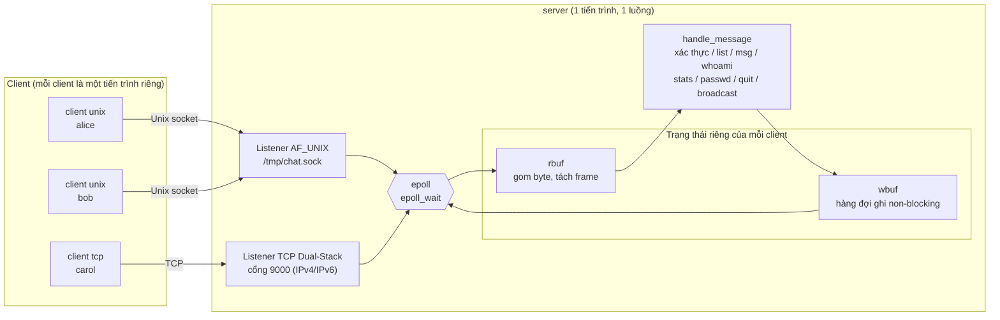
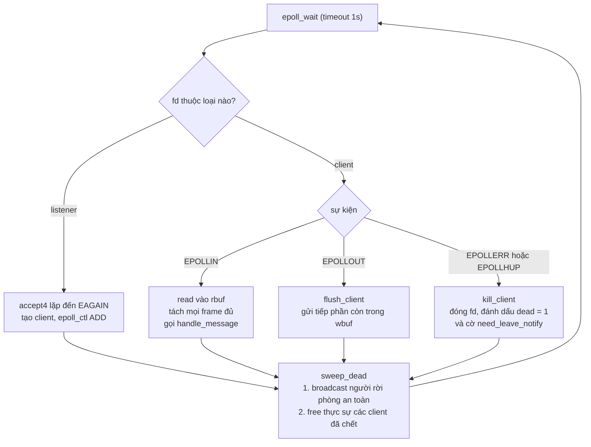
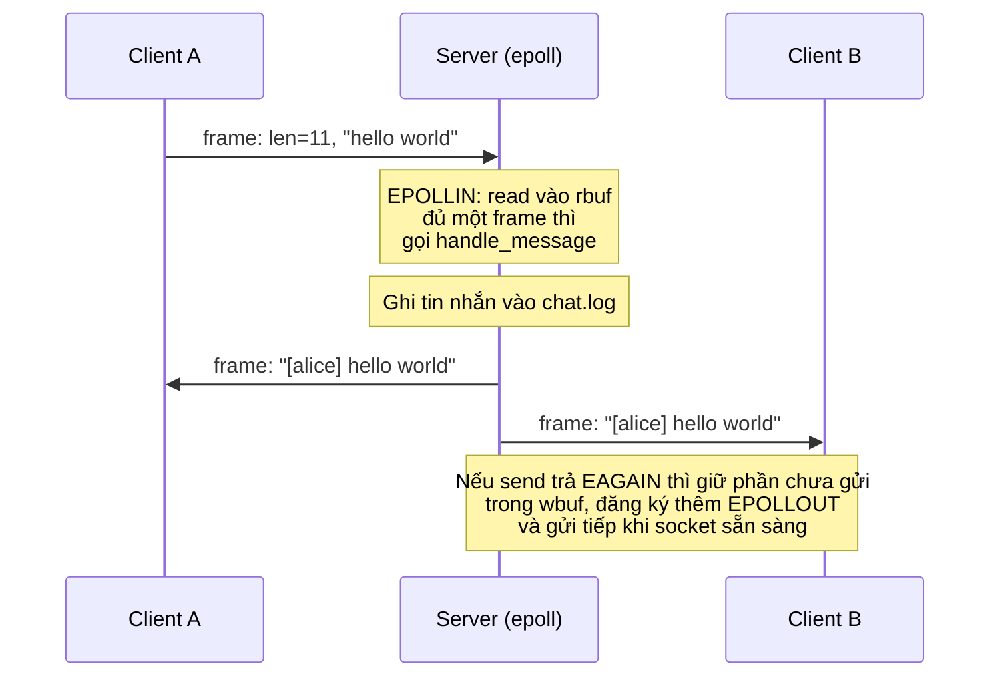
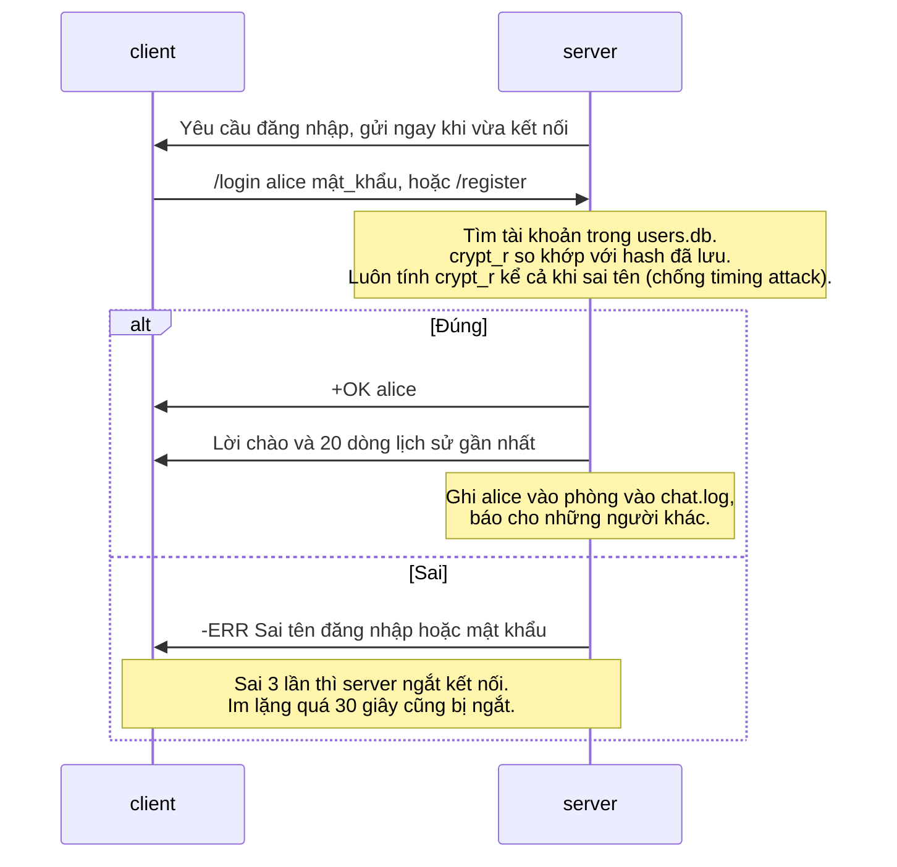

# Chat server đa client bằng `epoll` — Sockets trong IPC

Đồ án cuối kỳ môn **Lập trình hệ thống** · Ngôn ngữ **C** · Nền tảng **Linux (Arch / Ubuntu)**

Một chat server đơn tiến trình, đơn luồng, phục vụ **đồng thời** client kết nối qua
**Unix domain socket** (`AF_UNIX`) và **TCP** (`AF_INET` / `AF_INET6` dual-stack) bằng cơ chế `epoll` non-blocking.
Client phải **đăng ký / đăng nhập bằng username và mật khẩu** mới vào được phòng: tài khoản lưu trong file
`users.db` (mật khẩu được băm bằng thuật toán `yescrypt`, không lưu dạng thô), mọi tin nhắn công khai được ghi vào `chat.log`
(append-only) và tự động phát lại 20 dòng gần nhất cho người vừa đăng nhập.
Kèm chương trình **benchmark** so sánh độ trễ và thông lượng của **6 cơ chế IPC**:
pipe, Unix stream, Unix datagram, Unix seqpacket, TCP loopback và POSIX Shared Memory (`shm`).
Tích hợp sẵn bộ kịch bản **kiểm thử tự động** (`make test`) bao quát 12 trường hợp kiểm thử.

## Mục lục

1. [Socket trong bức tranh IPC](#1-socket-trong-bức-tranh-ipc)
2. [Kiến trúc hệ thống](#2-kiến-trúc-hệ-thống)
3. [Giao thức và Xác thực](#3-giao-thức-và-xác-thực)
4. [Cấu trúc thư mục](#4-cấu-trúc-thư-mục)
5. [Build và chạy](#5-build-và-chạy)
6. [Kịch bản kiểm thử tự động](#6-kịch-bản-kiểm-thử-tự-động)
7. [Kịch bản demo](#7-kịch-bản-demo)
8. [Benchmark hiệu năng IPC](#8-benchmark-hiệu-năng-ipc)
9. [Ghi chú thiết kế hệ thống](#9-ghi-chú-thiết-kế-hệ-thống)
10. [Hạn chế và Hướng phát triển](#10-hạn-chế-và-hướng-phát-triển)
11. [Xử lý sự cố](#11-xử-lý-sự-cố)

---

## 1. Socket trong bức tranh IPC

| Cơ chế | Phạm vi | Hướng | Ranh giới tin nhắn | Ghi chú |
|---|---|---|---|---|
| Pipe / FIFO | Cùng máy | Một chiều | Không (byte stream) | Pipe cần quan hệ cha-con; FIFO có tên trong hệ thống file |
| Message queue (POSIX/SysV) | Cùng máy | Hai chiều qua hàng đợi | Có | Có độ ưu tiên; giới hạn kích thước theo cấu hình hệ điều hành |
| **Shared memory (POSIX shm)** | Cùng máy | Hai chiều | Tự quản | Nhanh nhất vì dữ liệu không copy qua kernel, đồng bộ bằng Semaphore |
| **Unix domain socket** | Cùng máy | Hai chiều | Tùy loại (`STREAM` không, `DGRAM`/`SEQPACKET` có) | Có địa chỉ là đường dẫn file, có thể truyền file descriptor (`SCM_RIGHTS`), đọc được PID/UID của đối phương (`SO_PEERCRED`) |
| **TCP/UDP socket** | Khác máy hoặc nội bộ | Hai chiều | `TCP` không, `UDP` có | Đi qua network stack, dùng được qua mạng |

Đồ án dùng hai loại socket chính: **`AF_UNIX` + `SOCK_STREAM`** và **`AF_INET`/`AF_INET6` + `SOCK_STREAM`**.
Vì cả hai đều là byte stream nên một `read()` **không** tương ứng với một tin nhắn;
đó là lý do giao thức có *framing* (xem [mục 3](#3-giao-thức-và-xác-thực)).

---

## 2. Kiến trúc hệ thống

### 2.1 Thành phần



Một `epoll` instance theo dõi cả hai socket lắng nghe lẫn mọi socket client.
Mỗi đối tượng đăng ký vào epoll bắt đầu bằng `struct handle { kind, fd }`, nên con trỏ
`epoll_event.data.ptr` cho biết ngay đó là listener Unix, listener TCP hay một client.

### 2.2 Vòng lặp sự kiện



### 2.3 Đường đi của một tin nhắn



---

## 3. Giao thức và Xác thực

Mỗi tin nhắn là một **frame** với tiền tố độ dài (*length-prefix framing*):

```
  0        4                          4 + len
  +--------+---------------------------+
  |  len   |          payload          |
  | uint32 |   len byte (văn bản)      |
  | big-end|   1 <= len <= 4096        |
  +--------+---------------------------+
```

- `len` là số nguyên 32 bit **big-endian** (`htonl`/`ntohl`), chỉ tính độ dài payload.
- Payload là văn bản, **không** có ký tự kết thúc `\0`.
- Server **ngắt** client nếu `len == 0` hoặc `len > 4096` (chống client gửi độ dài giả để ép server cấp phát bộ nhớ).
- Vì TCP và `SOCK_STREAM` là dòng byte, một frame có thể đến thành nhiều mẩu, hoặc nhiều frame đến chung một lần `read()`. Cả server lẫn client đều gom byte vào buffer rồi mới tách frame qua module dùng chung [`src/proto.c`](src/proto.c).

### Xác thực

Vừa kết nối, client ở trạng thái **chưa đăng nhập**: server chỉ chấp nhận hai lệnh dưới đây, mọi thứ khác bị từ chối và client không nhận được tin của phòng:

| Lệnh | Tác dụng | Phản hồi |
|---|---|---|
| `/login <tên> <mật khẩu>` | Đăng nhập tài khoản đã có | `+OK <tên>` hoặc `-ERR <lý do>` |
| `/register <tên> <mật khẩu>` | Tạo tài khoản mới rồi đăng nhập luôn | `+OK <tên>` hoặc `-ERR <lý do>` |



- Tên đăng nhập chỉ gồm `A-Z a-z 0-9 _`, tối đa 16 ký tự. Mật khẩu dài 6 đến 72 ký tự và được phép chứa dấu cách.
- Lỗi đăng nhập luôn là câu chung ("Sai tên đăng nhập hoặc mật khẩu"), không làm lộ tên người dùng tồn tại.
- Một tài khoản chỉ đăng nhập ở một nơi tại một thời điểm.
- Client (`./client`) tự lo bước này: hỏi tên và mật khẩu (ẩn ký tự khi gõ), gửi lệnh, đợi `+OK`, và hỏi lại nếu bị từ chối.

### Lệnh trong phòng chat (sau khi đăng nhập)

| Nhập | Tác dụng |
|---|---|
| `nội dung bất kỳ` | Gửi cho mọi người (broadcast), có ghi vào lịch sử `chat.log` |
| `/list` | Liệt kê người đang online kèm loại kết nối (`unix` hoặc `tcp`) |
| `/msg <tên> <nội dung>` | Tin nhắn riêng tư, **không** ghi vào lịch sử |
| `/whoami` | Xem thông tin chi tiết phiên kết nối (username, kênh, địa chỉ/PID/UID, thời gian online) |
| `/stats` | Xem thống kê máy chủ (thời gian chạy uptime, số kết nối, user online, tổng tin nhắn) |
| `/passwd <cũ> <mới>` | Đổi mật khẩu tài khoản trực tiếp (cập nhật nguyên tử vào `users.db`) |
| `/help` | Xem danh sách lệnh hỗ trợ |
| `/quit` | Thoát khỏi phòng chat |

Tên hiển thị chính là tên đăng nhập đã xác thực.

### Tệp dữ liệu

Cả hai tệp được tạo tự động ở lần chạy đầu với quyền `0600`. Nếu tệp đã có với quyền rộng hơn, server cảnh báo và siết lại `0600`.

**`users.db`**: mỗi dòng một tài khoản, dạng `tên:hash`. Hash do `crypt(3)` của libxcrypt sinh ra
(mặc định **yescrypt**, có salt ngẫu nhiên riêng cho mỗi tài khoản, dự phòng SHA-512), nên mật khẩu
thô không bao giờ nằm trong file. Dòng trống, dòng bắt đầu bằng `#` và dòng sai định dạng bị bỏ qua.

```
alice:$y$j9T$L16jR0fC.kpZOS4528a7rxUUF7hop...
bob:$y$j9T$B4o5/ei8MyjbDKokJZ...
```

**`chat.log`**: mỗi dòng một sự kiện, ba cột ngăn bằng tab: thời gian, người gửi, nội dung.
Người gửi là `*` với sự kiện hệ thống (vào hoặc rời phòng). Ký tự điều khiển trong nội dung
được đổi thành dấu cách để một tin nhắn không thể chèn thêm dòng giả vào file.

```
2026-10-25 15:43:40	*	carol vao phong
2026-10-25 15:43:40	carol	xin chao tu carol
2026-10-25 15:43:40	*	carol roi phong
```

Khi đăng nhập, server đọc phần cuối của `chat.log` bằng `pread` và gửi lại tối đa 20 dòng gần nhất cho người đó.

---

## 4. Cấu trúc thư mục

```
.
├── .gitignore     loại trừ binary, log và file db khỏi kho mã git
├── README.md      tài liệu hướng dẫn tổng quan đồ án
├── docs/
│   ├── BaoCao.md  báo cáo chi tiết đồ án (kiến trúc, benchmark, phân tích số liệu)
│   ├── Phan_tich_du_an.md phân tích kỹ thuật và kiến thức lập trình hệ thống
│   └── Bao_cao_Sockets_trong_IPC_-_Chat_server_da_client_bang_epoll.docx
└── src/
    ├── Makefile   kịch bản biên dịch (make, make debug, make test, make clean)
    ├── proto.h    định nghĩa giao thức frame và các hằng số chung
    ├── proto.c    hàm đóng gói/giải mã frame và I/O an toàn (write_full, read_exact)
    ├── server.c   epoll loop non-blocking, quản lý client, xác thực, lịch sử chat
    ├── client.c   poll() stdin + socket, ANSI line management, ẩn mật khẩu
    ├── bench.c    benchmark độ trễ và thông lượng 6 cơ chế IPC (kèm Shared Memory)
    ├── test.sh    kịch bản kiểm thử tích hợp tự động (12 test cases)
    ├── plot.py    vẽ biểu đồ trực quan hóa kết quả đo
    ├── results.csv kết quả đo benchmark
    ├── latency.png biểu đồ độ trễ
    └── throughput.png biểu đồ thông lượng
```

---

## 5. Build và chạy

### Yêu cầu hệ thống

- **Arch Linux**:
  ```bash
  sudo pacman -S base-devel libxcrypt gdb valgrind strace socat tmux python-matplotlib
  ```
- **Ubuntu / Debian**:
  ```bash
  sudo apt-get update && sudo apt-get install -y build-essential libcrypt-dev python3 python3-matplotlib
  ```

### Build

```bash
make            # bản -O2, không sanitizer (dùng cho demo và benchmark)
make debug      # server và client với AddressSanitizer + UBSan (dùng khi kiểm thử lỗi bộ nhớ)
make test       # chạy bộ kiểm thử tích hợp tự động 12 kịch bản
make clean      # xóa các binary biên dịch
make clean-bench# xóa kết quả đo benchmark và ảnh đồ thị
```

### Chạy server và client

```bash
# Chạy server với cấu hình mặc định (Unix: /tmp/chat.sock, TCP: cổng 9000)
./server

# Chạy server với tham số tùy chỉnh
./server -u /tmp/x.sock -p 9100 -d users.db -l chat.log

# Đăng ký tài khoản mới (-r) qua Unix socket hoặc TCP
./client -r unix                  # hỏi mật khẩu 2 lần
./client -r tcp 127.0.0.1 9000

# Đăng nhập vào phòng chat
./client unix                     # kết nối /tmp/chat.sock
./client unix /tmp/x.sock
./client tcp                      # kết nối TCP 127.0.0.1:9000
./client tcp 192.168.1.10 9000
```

Dừng server bằng `Ctrl+C`: server gửi thông báo shutdown tới các client, đóng kết nối an toàn, giải phóng bộ nhớ và `unlink` file socket.

---

## 6. Kịch bản kiểm thử tự động

Dự án tích hợp sẵn kịch bản kiểm thử tự động toàn diện trong file [`src/test.sh`](src/test.sh). Để chạy kiểm thử:

```bash
make test
```

Bộ kiểm thử tự động kiểm chứng 12 trường hợp:
1. Khởi động Server `epoll` song song Unix Domain Socket và TCP.
2. Đăng ký tài khoản mới qua Unix Domain Socket (`/register alice`).
3. Đăng ký tài khoản mới qua TCP Socket (`/register bob`).
4. Ngăn chặn đăng ký trùng tên tài khoản.
5. Kiểm tra bảo mật: Khóa và ngắt kết nối khi nhập sai mật khẩu 3 lần liên tiếp.
6. Trò chuyện broadcast chéo giữa client Unix socket và client TCP socket trong cùng phòng.
7. Gửi nhận tin nhắn riêng tư an toàn (`/msg`).
8. Kiểm tra tính năng truy vấn trạng thái phiên (`/whoami`) và thống kê server (`/stats`).
9. Đổi mật khẩu tài khoản trực tiếp (`/passwd`) và đăng nhập lại bằng mật khẩu mới.
10. Phòng thủ giao thức: Tự động ngắt kết nối ngay khi nhận frame có độ dài giả mạo (> 4096 byte).
11. Khả năng chịu lỗi (Fault-Tolerance): Client ngắt kết nối đột ngột, server phát hiện qua EOF và phát thông báo rời phòng mà không crash.
12. Dừng máy chủ an toàn (Graceful Shutdown) và tự động dọn dẹp file socket trên hệ thống.

---

## 7. Kịch bản demo

Dùng `tmux` hoặc mở 4–5 terminal.

**Bước 1. Khởi động server và ba client**

```bash
./server                        # terminal 1
./client -r unix                # terminal 2: đăng ký alice
./client -r unix                # terminal 3: đăng ký bob
./client -r tcp                 # terminal 4: đăng ký carol
```

Log của server hiển thị loại kết nối và danh tính đối phương, ví dụ
`unix pid=1157 uid=1000` (lấy bằng `SO_PEERCRED`) hoặc `tcp 127.0.0.1:47956`.
Khi gõ mật khẩu, terminal ẩn hoàn toàn ký tự.

**Bước 2. Chat và sử dụng lệnh**

- Nhắn tin chung: Alice và Carol trò chuyện trong cùng một phòng (dù 1 người dùng Unix socket, 1 người dùng TCP).
- Thử gõ tin nhắn dở trên terminal client: khi có tin nhắn mới từ người khác tới, cơ chế **ANSI line management** tự động xóa dòng, in tin nhắn mới và khôi phục lại nội dung đang gõ mà không bị đè chữ.
- Kiểm tra danh sách online: `/list`.
- Gửi tin nhắn riêng: `/msg bob xin chào`.
- Kiểm tra thông tin phiên: `/whoami`.
- Xem thống kê máy chủ: `/stats`.
- Đổi mật khẩu: `/passwd matkhau123 matkhaumoi456`.

**Bước 2b. Kiểm tra tính bền bỉ của dữ liệu**

```bash
cat users.db            # chỉ có hash ($y$...), không có mật khẩu thật
cat chat.log            # thời gian, người gửi, nội dung; không có tin /msg
./client unix           # thoát rồi đăng nhập lại: nhận lại 20 dòng lịch sử gần nhất
```

Dừng server bằng `Ctrl+C`, chạy lại: tài khoản và lịch sử vẫn còn nguyên vẹn trong file.

**Bước 3. Chứng minh server chịu lỗi**

Trong một terminal khác, chạy `kill -9 <pid của một client>`.
Server ghi log đóng kết nối, thông báo cho những người còn lại `*** user da roi phong` và **hoạt động bình thường không crash**.

**Bước 4. Quan sát hệ thống qua system call**

```bash
ss -xlp | grep chat.sock          # socket Unix đang lắng nghe
ss -tlnp | grep 9000              # socket TCP đang lắng nghe
sudo strace -p "$(pgrep -x server)" -e trace=epoll_wait,accept4,read,sendto,epoll_ctl
```

**Bước 5. Kiểm tra phòng thủ giao thức tự thiết kế**

```bash
# Gửi văn bản thô, không có tiền tố độ dài: server từ chối và ngắt kết nối ngay
echo "hello" | socat - UNIX-CONNECT:/tmp/chat.sock

# Gửi đúng một frame (4 byte độ dài = 5, rồi "hello")
printf '\x00\x00\x00\x05hello' | socat -t1 - UNIX-CONNECT:/tmp/chat.sock
```

---

## 8. Benchmark hiệu năng IPC

Chương trình đo lường định lượng và so sánh cả 6 cơ chế giao tiếp liên tiến trình:
`pipe`, `unix_stream`, `unix_dgram`, `unix_seqp`, `tcp` và `shm` (POSIX Shared Memory).

```bash
make
./bench > results.csv                 # khoảng 30 giây, tiến độ in ra stderr
./bench -q                            # chế độ nhanh (dưới 2 giây)
python3 plot.py results.csv           # tạo latency.png và throughput.png
```

| Tuỳ chọn | Ý nghĩa |
|---|---|
| `-m <cơ chế>` | Chỉ chạy cơ chế này, có thể lặp lại: `pipe`, `unix_stream`, `unix_dgram`, `unix_seqp`, `tcp`, `shm` |
| `-a <cpu>` `-b <cpu>` | Ghim tiến trình cha và con vào CPU qua `sched_setaffinity` (mặc định 0 và 1) |
| `-n` | Không ghim CPU |
| `-q` | Chế độ nhanh (quick mode, ít vòng lặp hơn) |

**Phương pháp đo**

- **Độ trễ**: Đo theo mô hình ping-pong (cha gửi `S` byte, con echo lại `S` byte). Đo RTT bằng `clock_gettime(CLOCK_MONOTONIC)`, bỏ vòng warm-up, báo cáo **nửa RTT ($RTT/2$)** với các phân vị trung bình, p50 và p99. Kích thước `S`: 64 B, 1 KiB, 4 KiB, 16 KiB, 64 KiB.
- **Thông lượng**: Cha gửi liên tục một chiều, con đọc hết. Thời gian tính từ lúc bắt đầu gửi đến khi hoàn tất. Đơn vị MB/s ($10^6\text{ byte/s}$).
- **Shared Memory**: Dùng `shm_open`, `ftruncate`, `mmap(MAP_SHARED)` và đồng bộ bằng POSIX Unnamed Semaphore (`sem_wait` / `sem_post`).
- Hai tiến trình được ghim CPU để giảm thiểu nhiễu từ bộ lập lịch kernel.

---

## 9. Ghi chú thiết kế hệ thống

1. **Module hóa giao thức (`proto.h` / `proto.c`)**: Tách biệt tầng đóng gói framing, kiểm tra độ dài big-endian và các hàm I/O an toàn (`write_full`, `read_exact`, `pack_frame`) dùng chung cho cả server và client.
2. **Buffer đọc riêng từng client (`rbuf`, `rlen`)**: Tách mọi frame hoàn chỉnh trong một lần đọc rồi `memmove` phần dư về đầu buffer.
3. **Buffer ghi riêng từng client (`wbuf`, `woff`, `wlen`)**: Khi `send()` trả về `EAGAIN`, phần chưa gửi được giữ lại trong hàng đợi và server đăng ký thêm `EPOLLOUT`. Nếu hàng đợi vượt quá 1 MiB (`WBUF_LIMIT`), server lập tức ngắt client đọc quá chậm để chống cạn kiệt bộ nhớ.
4. **Khử nguy cơ đệ quy (Reentrancy Hazard)**: `kill_client()` đóng fd, đánh dấu `dead = 1` và cờ `need_leave_notify`. Việc phát thông báo `*** user da roi phong` và giải phóng bộ nhớ thực sự được dời về `sweep_dead()` ở cuối vòng lặp. Điều này loại bỏ hoàn toàn nguy cơ đệ quy lồng nhau khi client bị ngắt trong lúc server đang lặp broadcast.
5. **Cấu trúc đa hình `struct handle`**: Nằm ở đầu mọi đối tượng đăng ký trong epoll, giúp con trỏ `epoll_event.data.ptr` phân biệt ngay listener Unix, listener TCP và client.
6. **Chống đè dòng chat ở Client (ANSI Line Management)**: Client dùng `poll()` trên stdin và socket. Khi có tin nhắn đến từ server, client dùng mã ANSI `\r\033[K` để xóa dòng hiện tại, in tin nhắn mới, rồi in lại prompt `> ` kèm nội dung đang gõ dở.
7. **Lưu mật khẩu bảo mật cao**: Mật khẩu thô không bao giờ nằm trong file hay bộ nhớ. Dùng `getrandom` sinh salt ngẫu nhiên, băm bằng `crypt_r` (yescrypt) và so khớp thời gian cố định (chống timing attack bằng cả dummy hash khi user không tồn tại).
8. **Đổi mật khẩu an toàn (`/passwd`)**: Cập nhật file `users.db` qua cơ chế ghi nguyên tử (atomic write qua file tạm `users.db.tmp` + `rename`) để đảm bảo database không bị hỏng nếu server dừng đột ngột.
9. **Dual-Stack IPv6 / IPv4**: Socket TCP mở `AF_INET6` với `IPV6_V6ONLY = 0`, phục vụ đồng thời cả kết nối IPv4 và IPv6 trên cùng một cổng (tự động fallback về IPv4 nếu kernel không có IPv6).
10. **Graceful Shutdown**: Server bắt tín hiệu `SIGINT`/`SIGTERM`, gửi thông báo shutdown tới toàn bộ client, flush sạch hàng đợi ghi trước khi đóng kết nối và `unlink` file socket.
11. **Lịch sử hội thoại append-only**: `chat.log` ghi bằng `write()` nguyên tử trên fd `O_APPEND`. Khi đăng nhập, server chỉ `pread` 32 KiB cuối file lấy 20 dòng gần nhất, thời gian xử lý không tăng theo dung lượng file.

---

## 10. Hạn chế và Hướng phát triển

- **Đơn luồng**: Xử lý `crypt_r` tốn 10–15 ms CPU chạy trực tiếp trong event loop có thể làm trễ tạm thời các kết nối khác nếu bị tấn công dò mật khẩu liên tục. Hướng phát triển: Chuyển tác vụ băm mật khẩu sang **Worker Thread Pool** (`pthread`).
- **Chưa có mã hóa truyền tải (TLS)**: Mật khẩu và nội dung truyền qua TCP dưới dạng plaintext. Hướng phát triển: Tích hợp thư viện **OpenSSL** (TLS v1.3).
- **Phân quyền socket Unix**: Socket Unix hiện được `chmod 0666` để thuận tiện demo. Trong môi trường production nhiều người dùng, nên đặt quyền `0660` theo nhóm (GID) và kiểm tra UID đối phương qua `SO_PEERCRED`.
- **Dung lượng `chat.log`**: File log hiện tại chỉ ghi thêm, chưa có cơ chế log rotation (cắt file theo dung lượng hoặc theo ngày).

---

## 11. Xử lý sự cố

| Triệu chứng | Nguyên nhân và cách xử lý |
|---|---|
| `bind(tcp): Address already in use` | Cổng đang bị tiến trình khác dùng. Tìm bằng `ss -tlnp \| grep 9000`, hoặc chạy `./server -p 9100` |
| Client báo `connect(unix): No such file or directory` | Server chưa chạy hoặc khác đường dẫn socket. Chạy server trước |
| Client báo `connect(unix): Connection refused` | File socket cũ còn sót nhưng không có tiến trình lắng nghe. Chạy lại server (server tự động `unlink` file cũ) |
| Dùng `nc` hoặc `socat` gõ chữ thô thì bị ngắt | Đúng thiết kế: giao thức yêu cầu tiền tố độ dài 4 byte. Dùng `./client` |
| `fatal error: crypt.h: No such file or directory` hoặc `cannot find -lcrypt` | Thiếu thư viện băm: trên Arch chạy `sudo pacman -S libxcrypt`; trên Ubuntu/Debian chạy `sudo apt-get install libcrypt-dev` |
| Client báo `Loi: Sai ten dang nhap hoac mat khau` | Nhập sai thông tin hoặc chưa có tài khoản. Chạy `./client -r ...` để đăng ký |
| Client báo `Ten dang nhap da ton tai` khi đăng ký | Tên đã có trong `users.db`, chọn tên đăng nhập khác |
| Client báo `Tai khoan dang duoc dung o noi khac` | Tài khoản đang được đăng nhập ở một client khác; thoát client đó trước |
| Quên mật khẩu | Dừng server, xóa dòng tương ứng trong `users.db`, khởi động lại server và đăng ký lại |
