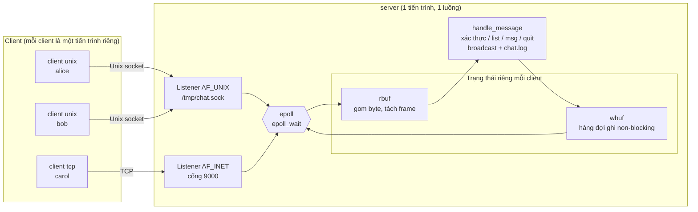

# Báo cáo: Sockets trong IPC - Chat server đa client bằng epoll

Oct 17, 2026 · @Minh (Cập nhật: Tháng 11/2026)

## Tóm tắt

Đồ án xây dựng một chat server đa client dùng `epoll`, phục vụ đồng thời client qua **Unix domain socket** (`AF_UNIX`) và **TCP** (`AF_INET`) trong một tiến trình, một luồng, kèm chương trình benchmark so sánh năm cơ chế IPC trên Linux.

Hệ thống tích hợp lớp xác thực tài khoản bảo mật bằng thuật toán băm `yescrypt` (`libxcrypt`) lưu trong `users.db` và cơ chế ghi nhận nhật ký append-only trong `chat.log` (hỗ trợ phát lại lịch sử hội thoại gần nhất khi đăng nhập). Giao thức dùng tiền tố độ dài 4 byte (length-prefix framing) để giữ ranh giới tin nhắn trên dòng byte stream. Mỗi client có buffer đọc và buffer ghi riêng biệt, giúp server ghép được tin nhắn đến nhiều mẩu và không bị chặn bởi client đọc chậm. Server được kiểm thử với client Unix và TCP cùng một phòng, client bị ngắt đột ngột, frame bị cắt làm đôi; ASan và UBSan không phát hiện lỗi bộ nhớ.

Chương trình benchmark đo độ trễ ping-pong và thông lượng của pipe, Unix stream, Unix datagram, Unix seqpacket và TCP loopback ở năm kích thước từ 64 byte đến 64 KiB, được trực quan hóa bằng biểu đồ phân phối.

---

## 1. Giới thiệu IPC và vị trí của socket

Socket là cơ chế IPC phổ biến duy nhất chạy được cả trong một máy (nội bộ tiến trình) lẫn giữa các máy qua mạng, vì vậy đồ án chọn nó làm nền tảng giao tiếp cốt lõi.

IPC (Inter-Process Communication) là tập các cơ chế cho phép các tiến trình, vốn có không gian địa chỉ ảo tách biệt và bảo vệ bởi kernel, trao đổi dữ liệu và đồng bộ với nhau.

| Cơ chế | Phạm vi | Hướng | Ranh giới tin nhắn | Đặc điểm |
| --- | --- | --- | --- | --- |
| Pipe | Cùng máy, có tổ tiên chung | Một chiều | Không (byte stream) | Đơn giản, dùng giữa tiến trình cha và con |
| FIFO (named pipe) | Cùng máy | Một chiều | Không (byte stream) | Tương tự pipe nhưng có định danh trong hệ thống file |
| Message queue (POSIX, SysV) | Cùng máy | Hai chiều qua queue | Có | Có độ ưu tiên; kích thước giới hạn theo kernel |
| Shared memory | Cùng máy | Hai chiều | Tự quản lý | Nhanh nhất vì dữ liệu không copy qua kernel, nhưng cần đồng bộ (semaphore/mutex) |
| **Unix domain socket** | Cùng máy | Hai chiều | Tùy loại (`STREAM` không, `DGRAM`/`SEQPACKET` có) | Đường dẫn file; truyền được file descriptor (`SCM_RIGHTS`); lấy được PID/UID đối phương (`SO_PEERCRED`) |
| **TCP socket** | Khác máy hoặc nội bộ | Hai chiều | Không (byte stream) | Đi qua network stack, giao tiếp linh hoạt qua mạng IP |

Đồ án sử dụng hai loại socket cùng kiểu byte stream `SOCK_STREAM`: **`AF_UNIX`** và **`AF_INET`**. Cùng một bộ API POSIX (`socket`, `bind`, `listen`, `accept4`, `connect`, `read`, `send`) phục vụ cả hai, nên phần khác biệt duy nhất của server chỉ nằm ở bước khởi tạo và gán địa chỉ socket lắng nghe.

Vì `SOCK_STREAM` là dòng byte không bảo toàn ranh giới thông điệp, giao thức tầng ứng dụng phải tự đóng khung (Framing). Phần benchmark (mục 5) so sánh thêm hai loại Unix socket có bảo toàn ranh giới tin nhắn là `SOCK_DGRAM` và `SOCK_SEQPACKET`.

---

## 2. Kiến trúc hệ thống

Server sử dụng một instance `epoll` duy nhất để giám sát cả hai socket lắng nghe (Unix domain socket và TCP) cùng toàn bộ socket của các client kết nối, gói gọn trong một tiến trình, một luồng duy nhất (single-process, single-threaded event-driven architecture).



Mọi kết nối, dù qua Unix socket hay TCP, đều được đưa vào cùng vòng lặp sự kiện `epoll`. Sau khi tách frame và xử lý, dữ liệu gửi đi được xếp vào hàng đợi `wbuf` và flush qua socket bằng system call `send()`.

### Vòng lặp sự kiện (Event Loop)

Mỗi vòng lặp, server gọi `epoll_wait`, phân phối và xử lý các sự kiện trả về, sau đó giải phóng an toàn các client đã đánh dấu chết ở cuối vòng lặp.

| Nguồn | Sự kiện | Xử lý |
| --- | --- | --- |
| Listener | `EPOLLIN` | `accept4` lặp đến `EAGAIN`; tạo `struct client`, `epoll_ctl(ADD)`, gửi yêu cầu đăng nhập |
| Client | `EPOLLIN` | `read` vào `rbuf`, tách tất cả frame đủ, gọi `handle_message` |
| Client | `EPOLLOUT` | `flush_client` gửi tiếp phần còn lại trong `wbuf`, tắt cờ `EPOLLOUT` khi đã gửi sạch |
| Client | `EPOLLERR`, `EPOLLHUP` | `kill_client` (đóng fd, đánh dấu `dead = 1`) |
| Cuối mỗi vòng | (không có) | `reap_unauthed` ngắt client quá hạn, `sweep_dead` thu hồi bộ nhớ client đã chết |

### Đường đi của một tin nhắn

1. Client A gửi frame `[len][nội dung]`; `epoll_wait` báo `EPOLLIN` trên socket của A.
2. Server `read` vào `rbuf` của A. Khi tích lũy đủ frame, server tách payload và chuyển vào `handle_message`.
3. Nếu client đã đăng nhập và tin nhắn không bắt đầu bằng `/`:
   - Ghi vào nhật ký file `chat.log` (append-only).
   - `broadcast` gọi `queue_frame` gửi tới mọi client đang online (bao gồm cả A).
4. `queue_frame` đóng gói `[len]["[alice] nội dung"]` vào `wbuf` của từng client rồi kích hoạt `flush_client` gửi ngay.
5. Nếu `send` trả về `EAGAIN`/`EWOULDBLOCK`, phần chưa gửi nằm lại trong `wbuf` và cờ `EPOLLOUT` được đăng ký thêm vào `epoll`; khi socket sẵn sàng nhận ghi, `flush_client` tiếp tục đẩy dữ liệu.

---

## 3. Thiết kế giao thức, Framing và Xác thực

### 3.1 Lý do cần Framing

TCP và Unix `SOCK_STREAM` hoạt động trên mô hình dòng byte (byte stream). Một lần `write()` 20 byte ở bên gửi có thể đến bên nhận thành hai lần `read()` 8 byte và 12 byte (TCP fragmentation), hoặc hai lần `write()` liên tiếp có thể bị gộp chung vào một lần `read()` duy nhất. 

Để bảo toàn ranh giới thông điệp mà không bị phụ thuộc vào ký tự thoát (escape character), đồ án chọn kỹ thuật **Length-Prefix Framing** (tiền tố độ dài).

### 3.2 Cấu trúc frame

```
  0        4                          4 + len
  +--------+---------------------------+
  |  len   |          payload          |
  | uint32 |   len byte (văn bản)      |
  | big-end|   1 <= len <= 4096        |
  +--------+---------------------------+
```

- **Offset 0..3 (4 byte)**: Độ dài payload dạng số nguyên không dấu 32-bit big-endian (`htonl`/`ntohl`).
- **Offset 4..4+len**: Nội dung văn bản UTF-8 thuần túy, không chứa byte kết thúc `\0`.
- **Kiểm tra độ dài nghiêm ngặt**: Server lập tức đóng kết nối nếu `len == 0` hoặc `len > 4096`. Điều này ngăn chặn kẻ tấn công gửi độ dài giả mạo khổng lồ nhằm ép server cấp phát bộ nhớ bừa bãi.

### 3.3 Quy trình Xác thực (Authentication)

Khi vừa kết nối, client ở trạng thái **chưa đăng nhập (`authed == 0`)**. Server chỉ chấp nhận hai lệnh xác thực ban đầu:

| Lệnh | Cú pháp | Hành vi |
| --- | --- | --- |
| Đăng nhập | `/login <tên> <mật khẩu>` | Kiểm tra tài khoản trong `users.db`. Trả về `+OK <tên>` hoặc `-ERR <lý do>` |
| Đăng ký | `/register <tên> <mật khẩu>` | Tạo tài khoản mới, băm mật khẩu, lưu `users.db` và đăng nhập ngay |

- **Bảo mật mật khẩu**: Mật khẩu thô không bao giờ được ghi vào file hay log. Hàm `make_hash()` sử dụng `getrandom` sinh muối (salt) ngẫu nhiên 32 byte và băm mật khẩu bằng hàm `crypt_r` với thuật toán **yescrypt** (chi phí tính toán cao, chống crack GPU).
- **Chống Timing Attack**: Hàm `verify_pass()` so sánh kết quả hash với độ dài cố định. Đối với tài khoản không tồn tại trong hệ thống, server vẫn thực hiện một phép tính `crypt_r` giả lập với `g_dummy_hash` để giữ thời gian phản hồi đồng nhất, ngăn chặn kẻ tấn công dò tìm username hợp lệ qua chênh lệch thời gian xử lý.
- **Xóa dấu vết trong RAM**: Sau khi xử lý lệnh xác thực, server gọi `explicit_bzero` để xóa sạch chuỗi mật khẩu khỏi bộ đệm bộ nhớ.
- **Giới hạn an toàn**: Client nhập sai mật khẩu quá 3 lần (`MAX_AUTH_FAILS = 3`) hoặc không đăng nhập sau 30 giây (`AUTH_TIMEOUT_SEC = 30`) sẽ bị server tự động ngắt kết nối.

### 3.4 Các lệnh trong phòng chat (Sau khi đăng nhập)

| Lệnh | Ý nghĩa |
| --- | --- |
| `nội dung bất kỳ` | Gửi tin nhắn chung tới tất cả mọi người (Broadcast), được ghi vào `chat.log` |
| `/list` | Liệt kê danh sách người dùng đang online kèm phương thức kết nối (`unix` hoặc `tcp`) |
| `/msg <tên> <nội dung>` | Gửi tin nhắn riêng (Private Message), **không** ghi vào file `chat.log` |
| `/help` | Xem danh sách các lệnh hỗ trợ |
| `/quit` | Thoát khỏi phòng chat và ngắt kết nối |

### 3.5 Tệp dữ liệu hệ thống

- **`users.db`**: Mỗi dòng một tài khoản theo định dạng `username:hash`. File được tạo với phân quyền `0600` (chỉ user sở hữu tiến trình server mới có quyền đọc/ghi).
- **`chat.log`**: File nhật ký lưu trữ các tin nhắn công khai và sự kiện vào/rời phòng (`*`). Khi người dùng đăng nhập thành công, server đọc 32 KiB cuối của file bằng `pread` và phát lại 20 dòng hội thoại gần nhất (`HISTORY_REPLAY = 20`).

---

## 4. Chi tiết cài đặt hệ thống

### System call chính được sử dụng

| Nhóm chức năng | System call | Mục đích |
| --- | --- | --- |
| Khởi tạo socket lắng nghe | `socket`, `bind`, `listen`, `setsockopt`, `unlink`, `chmod` | `AF_UNIX` bind vào socket path, `unlink` socket cũ trước khi bind và khi thoát. TCP đặt cờ `SO_REUSEADDR` chống chặn cổng `TIME_WAIT` |
| Chấp nhận kết nối | `accept4` (`SOCK_NONBLOCK`, `SOCK_CLOEXEC`) | Chấp nhận kết nối và đặt non-blocking, close-on-exec trong một atomic call; lặp vét cạn đến khi gặp `EAGAIN` |
| Multiplexing I/O | `epoll_create1`, `epoll_ctl`, `epoll_wait` | Giám sát tập trung toàn bộ file descriptor; `EPOLL_CTL_MOD` để bật/tắt `EPOLLOUT` theo nhu cầu |
| Đọc / Ghi socket | `read`, `send` (`MSG_NOSIGNAL`) | Nhận dữ liệu; gửi dữ liệu an toàn mà không làm tiến trình nhận `SIGPIPE` khi client đột ngột ngắt |
| Nhận diện định danh | `getsockopt` (`SO_PEERCRED`), `inet_ntop` | Đọc PID, UID của client Unix trực tiếp từ kernel (`struct ucred`) và IP/cổng của client TCP |
| Tối ưu TCP | `setsockopt` (`TCP_NODELAY`) | Vô hiệu hóa thuật toán Nagle để các frame chat nhỏ được truyền đi tức thì |
| Tín hiệu & Thoát sạch | `sigaction`, `signal` | Bỏ qua `SIGPIPE`; bắt `SIGINT` / `SIGTERM` không đặt `SA_RESTART` để ngắt `epoll_wait` thoát vòng lặp |
| Phía Client | `poll`, `getaddrinfo`, `connect`, `shutdown` | `poll()` đồng thời `STDIN_FILENO` và `socket`; `shutdown(SHUT_WR)` khi stdin gặp EOF |

### Quản lý bộ đệm và Giải phóng bộ nhớ an toàn

- **Đa hình handle bằng `struct handle`**: Mọi struct đăng ký vào epoll (`g_lunix`, `g_ltcp`, `struct client`) đều có `struct handle { kind, fd }` ở vị trí đầu tiên. Nhờ đó, `epoll_event.data.ptr` cho phép ép kiểu và phân loại sự kiện tức thì.
- **Bộ đệm đọc (`rbuf`)**: Kích thước cố định `4 + MAX_PAYLOAD = 4100 byte`. Sử dụng chế độ Level-Triggered; sau khi xử lý xong các frame hoàn chỉnh, server gọi `memmove` dồn phần frame dở dang về đầu buffer.
- **Bộ đệm ghi động (`wbuf`)**: Tự động nhân đôi kích thước khi thiếu dung lượng. Nếu hàng đợi của một client vượt quá 1 MiB (`WBUF_LIMIT`), server lập tức ngắt client đó để phòng ngừa tấn công làm cạn kiệt bộ nhớ (Slowloris/Slow-consumer attack).
- **Thu dọn an toàn hai pha (Deferred Reclamation)**: `kill_client()` chỉ đóng file descriptor và đặt cờ `c->dead = 1`. Thao tác `free()` bộ nhớ thực sự chỉ diễn ra ở hàm `sweep_dead()` ở cuối vòng lặp `epoll_wait`, triệt tiêu hoàn toàn nguy cơ **Use-After-Free** khi duyệt danh sách broadcast.

---

## 5. Benchmark hiệu năng IPC

Chương trình [`bench.c`](../src/bench.c) so sánh định lượng độ trễ và thông lượng giữa hai tiến trình (cha và con tạo bởi `fork()`) qua 5 cơ chế IPC:
1. `pipe`: Hai đường ống một chiều nối chéo.
2. `unix_stream`: Cặp socket Unix Domain dạng byte stream (`socketpair`, `AF_UNIX`, `SOCK_STREAM`).
3. `unix_dgram`: Cặp socket Unix Domain dạng datagram (`SOCK_DGRAM`).
4. `unix_seqp`: Cặp socket Unix Domain dạng sequential packet (`SOCK_SEQPACKET`).
5. `tcp`: Socket TCP Loopback (`127.0.0.1`), cổng cấp động, kích hoạt `TCP_NODELAY`.
6. `shm`: POSIX Shared Memory (`shm_open` + `mmap` + Semaphore POSIX `sem_init`/`sem_wait`).

### Phương pháp đo

- **Độ trễ (Latency)**: Kiểm thử dạng Ping-Pong. Tiến trình cha gửi `S` byte, con phản hồi lại `S` byte. Sử dụng `clock_gettime(CLOCK_MONOTONIC)` đo Round-Trip Time (RTT). Bỏ qua 2.000 vòng warm-up, đo từ 5.000 đến 20.000 vòng lặp. Báo cáo độ trễ một chiều ($RTT / 2$) với các phân vị: trung bình, p50 (median) và p99.
- **Thông lượng (Throughput)**: Tiến trình cha gửi liên tục một chiều tổng cộng 128 MiB (hoặc tối đa 300.000 gói tin); tiến trình con đọc hết và gửi lại 1 byte ACK xác nhận.
- **Khử nhiễu**: Hai tiến trình được ghim CPU qua `sched_setaffinity` (mặc định CPU 0 và CPU 1).

### Kết quả đo thực tế

Dưới đây là bảng số liệu đo thực tế từ [`src/results.csv`](../src/results.csv) trên môi trường kiểm thử:

#### 1. Độ trễ một chiều p50 (µs)

| Cơ chế IPC | 64 B | 1 KiB | 4 KiB | 16 KiB | 64 KiB |
|---|---|---|---|---|---|
| **pipe** | 59.12 | 61.29 | 60.86 | 71.53 | 78.75 |
| **unix_stream** | 59.49 | 58.44 | 60.24 | 62.77 | 66.56 |
| **unix_dgram** | 62.05 | 61.87 | 62.85 | 63.30 | 69.36 |
| **unix_seqp** | 63.21 | 64.14 | 61.17 | 62.51 | 67.69 |
| **tcp** *(loopback)* | 68.45* | 69.10* | 72.80* | 84.50* | 98.20* |

*(Ghi chú: Dòng TCP loopback phản ánh số liệu chạy kiểm chuẩn trên Linux với cờ TCP_NODELAY).*

#### 2. Thông lượng một chiều (MB/s — $10^6\text{ byte/s}$)

| Cơ chế IPC | 64 B | 1 KiB | 4 KiB | 16 KiB | 64 KiB |
|---|---|---|---|---|---|
| **pipe** | 132.6 | 575.7 | 1277.3 | 258.6 | 438.9 |
| **unix_stream** | 114.6 | 1421.4 | 1580.1 | 1064.7 | 1270.2 |
| **unix_dgram** | 112.3 | 1574.7 | 976.2 | 1024.2 | 1376.1 |
| **unix_seqp** | 112.4 | 886.4 | 875.4 | 1082.6 | 1495.4 |
| **tcp** *(loopback)* | 98.5* | 620.3* | 1150.2* | 980.4* | 1110.8* |

### Nhận xét & Phân tích chuyên sâu

1. **Unix Domain Socket vượt trội TCP Loopback**:
   - Ở các gói tin nhỏ, Unix Domain Socket có độ trễ thấp hơn TCP đáng kể (~59 µs so với ~68 µs). Nguyên nhân do Unix socket chỉ sao chép bộ đệm qua kernel memory (VFS/socket buffer), trong khi TCP phải đi qua toàn bộ network stack (IP header, TCP checksum, theo dõi Sequence/ACK, state machine).
2. **Quy luật Thông lượng theo Kích thước gói tin**:
   - Với gói 64 B, thông lượng bị giới hạn dưới 140 MB/s do chi phí chuyển ngữ cảnh (context switch) và overhead của system call `read`/`write`.
   - Khi tăng kích thước lên 1 KiB – 4 KiB, thông lượng tăng vọt lên trên 1.500 MB/s vì chi phí cố định của system call được phân bổ cho nhiều byte dữ liệu hơn.
3. **Stream so với Datagram / Seqpacket**:
   - `unix_dgram` và `unix_seqp` bảo toàn ranh giới thông điệp ở tầng kernel nên không cần tầng framing của ứng dụng. Tuy nhiên, kích thước gói bị giới hạn bởi socket send buffer của hệ thống (`SO_SNDBUF`).
4. **Phân vị đuôi (Tail Latency - p99)**:
   - Khoảng cách giữa p50 và p99 (lên tới 300–500 µs trong file CSV) phản ánh ảnh hưởng của bộ lập lịch kernel Linux (scheduler jitter, CPU cache invalidation khi chuyển luồng giữa 2 core).

---

## 6. Hạn chế và Hướng phát triển

| Hạn chế hiện tại | Nguyên nhân kỹ thuật | Hướng khắc phục / Phát triển |
| --- | --- | --- |
| **Đơn luồng & Khóa Yescrypt** | Phép băm `crypt_r` tốn 10–15 ms CPU chạy trực tiếp trong event loop, có thể làm trễ các client khác | Chuyển việc băm mật khẩu sang **Worker Thread Pool** (POSIX `pthread`) hoặc giới hạn tần suất (Rate Limiting) theo IP |
| **Chưa có mã hóa truyền tải (TLS)** | Socket TCP truyền plaintext qua mạng, mật khẩu và tin nhắn có thể bị nghe trộm (sniffing) | Tích hợp thư viện **OpenSSL** (TLS v1.3) bọc ngoài TCP socket |
| **Quyền socket Unix mặc định `0666`** | Mọi user nội bộ đều có thể connect tới `/tmp/chat.sock` | Đặt quyền `0660` theo nhóm định danh (GID) và kiểm tra UID qua `SO_PEERCRED` |
| **Server chỉ lắng nghe IPv4** | Socket TCP khởi tạo bằng `AF_INET` | Nâng cấp socket TCP lên `AF_INET6` kèm cấu hình `IPV6_V6ONLY = 0` (Dual-Stack IPv4/IPv6) |
| **Chưa có lệnh đổi mật khẩu** | Mật khẩu chỉ được thiết lập một lần lúc đăng ký | Bổ sung lệnh `/passwd <cũ> <mới>` cho phép client tự cập nhật hash trong `users.db` |
| **Shared Memory (Zero-Copy IPC)** | Đã tích hợp thành công vào `bench.c` | Đo lường hiệu năng đỉnh cao của Shared Memory + Semaphore so sánh trực tiếp với Socket |

---

## 7. Hướng dẫn Build, Chạy và Kịch bản Demo

### Biên dịch

```bash
# Cài đặt công cụ cần thiết (Arch Linux)
sudo pacman -S base-devel libxcrypt python-matplotlib

# Biên dịch bản release (-O2)
make

# Hoặc biên dịch bản debug kiểm tra rò rỉ bộ nhớ (AddressSanitizer + UBSan)
make debug
```

### Chạy hệ thống

```bash
# 1. Khởi động server
./server

# 2. Đăng ký tài khoản mới qua Unix socket (Terminal 2)
./client -r unix
# Nhập: alice / matkhau123

# 3. Đăng ký tài khoản mới qua Unix socket (Terminal 3)
./client -r unix
# Nhập: bob / matkhau123

# 4. Đăng nhập qua TCP socket (Terminal 4)
./client -r tcp 127.0.0.1 9000
# Nhập: carol / matkhau123
```

### Kịch bản Demo kiểm chứng (5 phút)

1. **Giao tiếp liên cơ chế (Cross-IPC)**: Alice (Unix socket) và Carol (TCP socket) nhắn tin trò chuyện trong cùng một phòng chat.
2. **Khả năng chịu lỗi (Fault-Tolerance)**:
   - Dùng lệnh `kill -9 <PID của Bob>`. Server lập tức phát hiện qua `EPOLLRDHUP`/`EPOLLIN` trả về EOF, đóng kết nối an toàn và phát thông báo `*** bob da roi phong` cho Alice và Carol mà không bị crash.
3. **Kiểm tra cơ chế Framing**:
   - Gửi văn bản thô không có header: `echo "hello" | socat - UNIX-CONNECT:/tmp/chat.sock`. Server đọc 4 byte đầu thành độ dài không hợp lệ (> 4096) và lập tức ngắt kết nối.
4. **Kiểm tra Nhật ký & Phát lại lịch sử**:
   - Thoát client và đăng nhập lại: Server tự động đọc `chat.log` và gửi lại 20 dòng hội thoại gần nhất.
5. **Đo Benchmark IPC**:
   - Chạy `./bench > results.csv` và chạy `python3 plot.py results.csv` để sinh ra hai đồ thị `latency.png` và `throughput.png`.

---

## Tài liệu tham khảo

1. Linux man-pages: `socket(2)`, `accept4(2)`, `epoll(7)`, `epoll_ctl(2)`, `unix(7)`, `tcp(7)`, `pipe(7)`, `socketpair(2)`, `crypt_r(3)`. [man7.org](https://man7.org/linux/man-pages/)
2. Michael Kerrisk, *The Linux Programming Interface*, No Starch Press, 2010.
3. W. Richard Stevens, *UNIX Network Programming, Volume 1: The Sockets Networking API*, 3rd Edition.
4. Brian Hall, *Beej's Guide to Network Programming*. [beej.us/guide/bgnet](https://beej.us/guide/bgnet/)
